# Endpoint sequence diagrams

This guide shows the runtime sequence for every public HTTP operation in PayRelay. All management routes under `/v1` require a configured Bearer API key; `/healthz` and `/docs/` are public.

## Health check

### `GET /healthz`

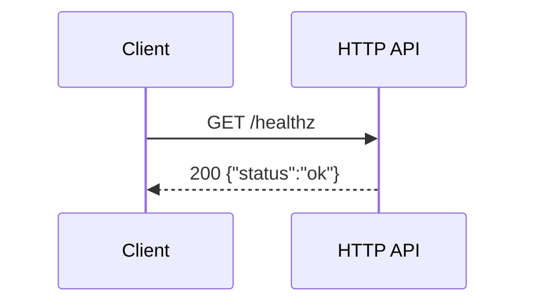

## Webhook endpoints

### `POST /v1/endpoints`

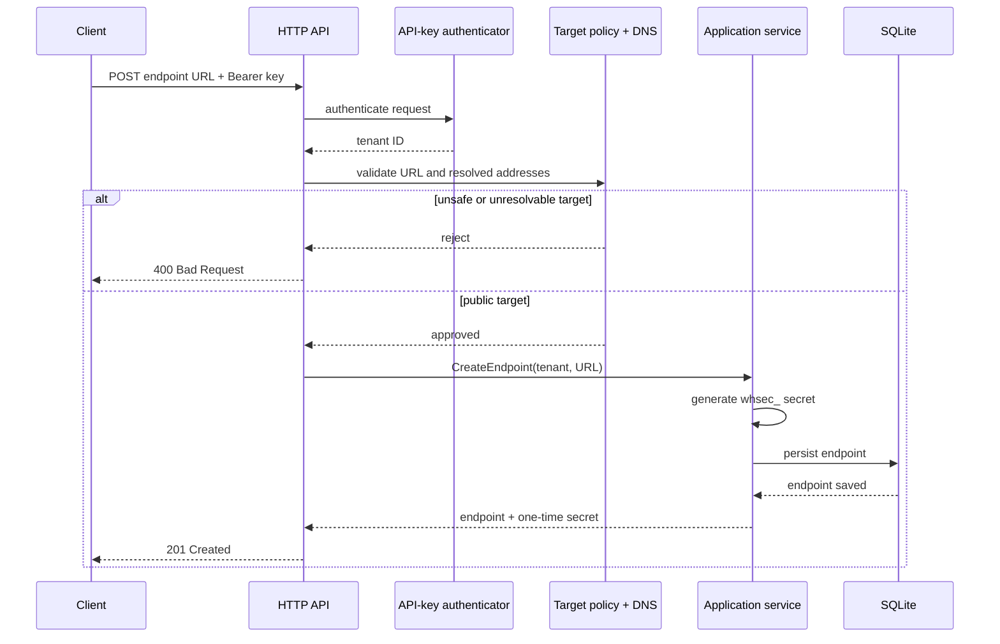

### `GET /v1/endpoints`

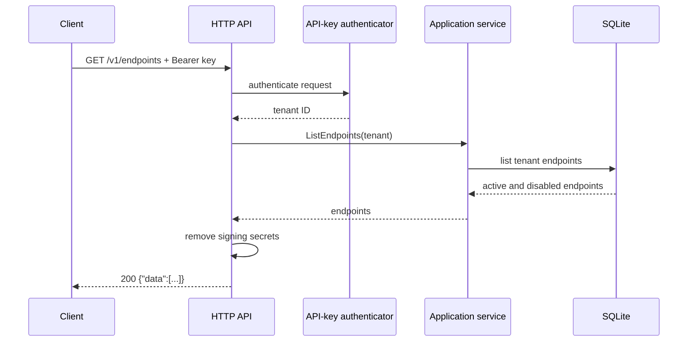

### `GET /v1/endpoints/{endpointID}`

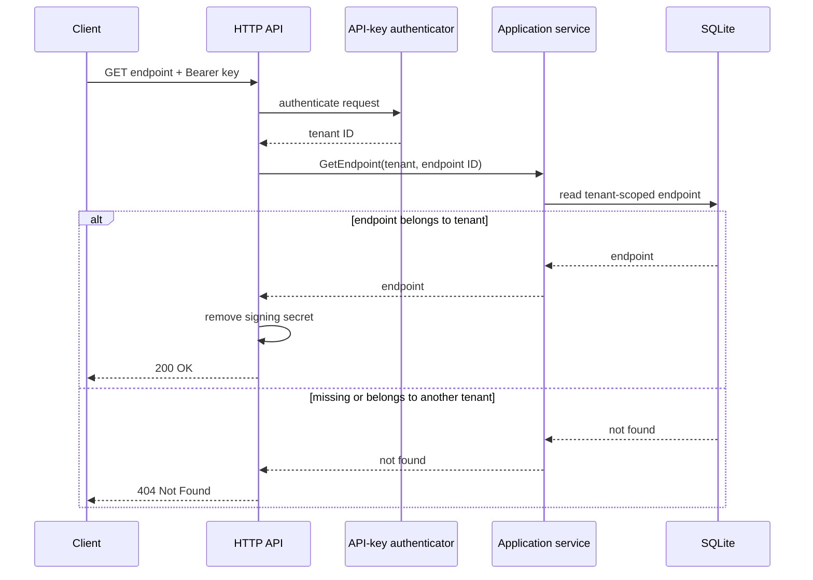

### `PATCH /v1/endpoints/{endpointID}`

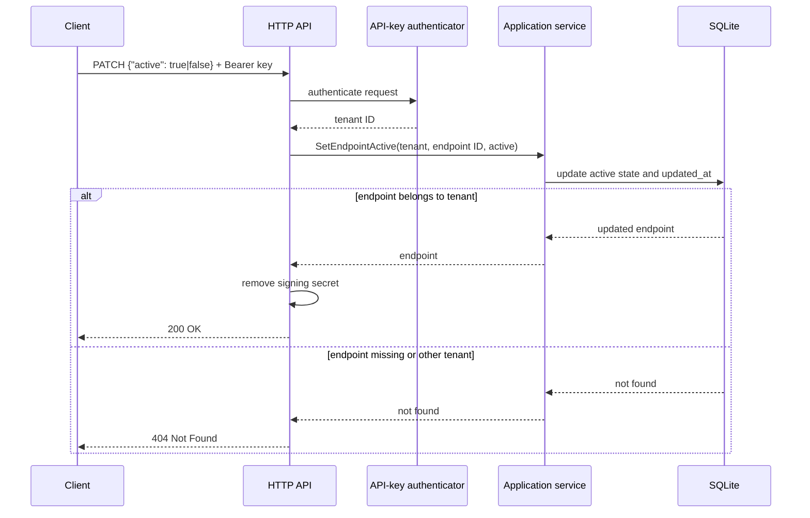

### `POST /v1/endpoints/{endpointID}/rotate-secret`

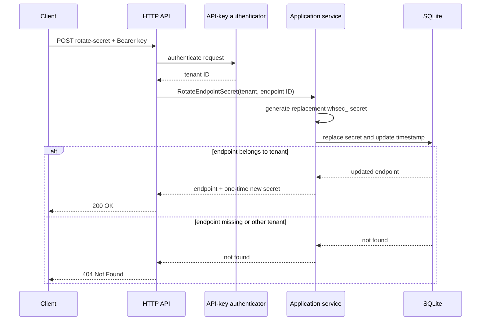

## Mock payment events

### `POST /v1/events`

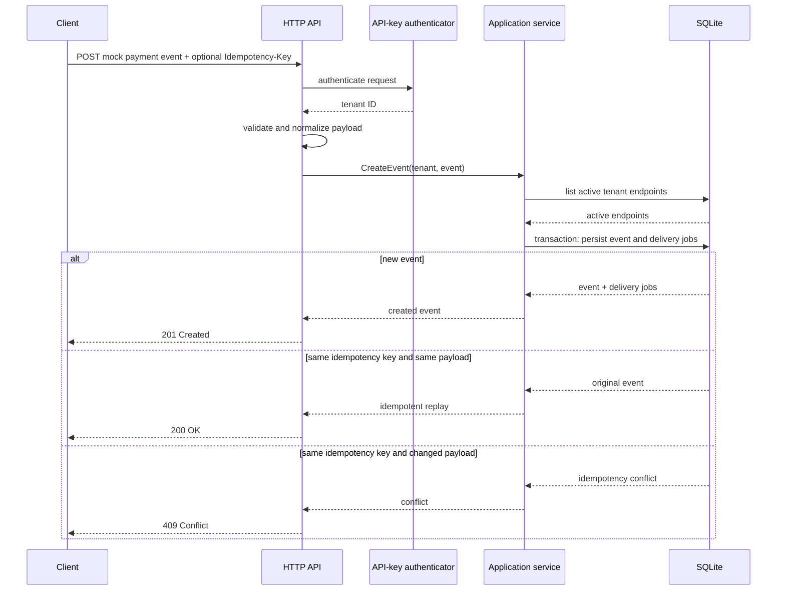

### `GET /v1/events/{eventID}`

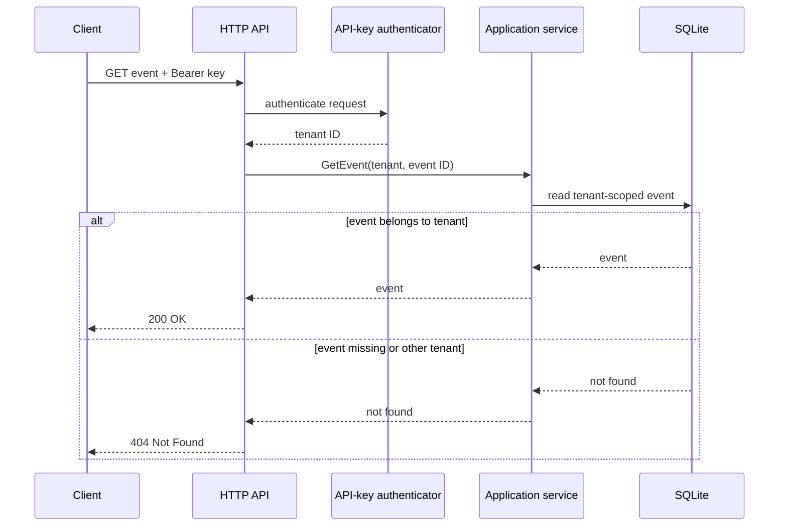

### `GET /v1/events/{eventID}/deliveries`

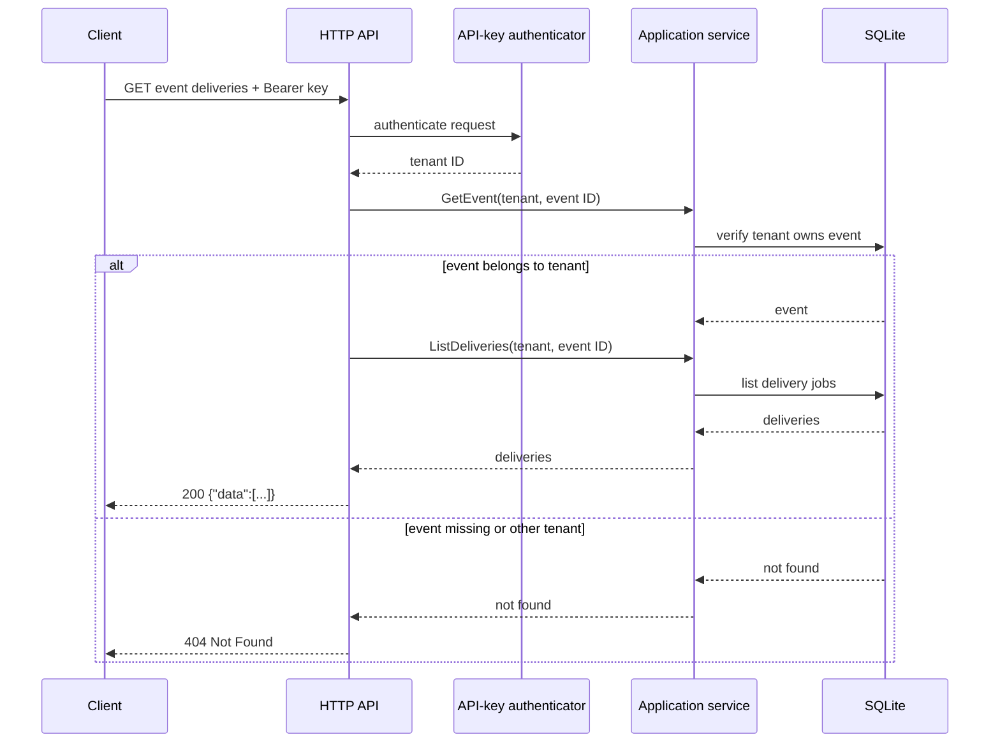

## Delivery operations

### `GET /v1/deliveries/{deliveryID}/attempts`

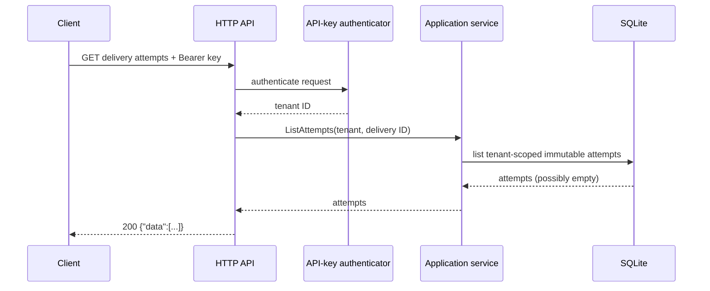

### `POST /v1/deliveries/{deliveryID}/replay`

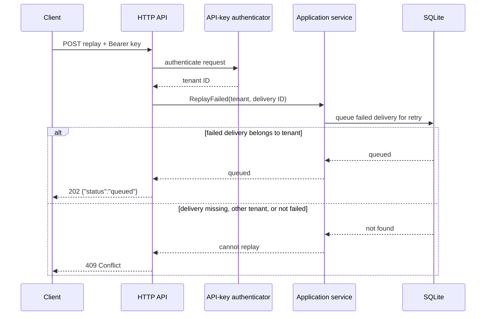

## Background delivery lifecycle

This is not a public HTTP operation, but it shows how jobs created by `POST /v1/events` reach a receiver.

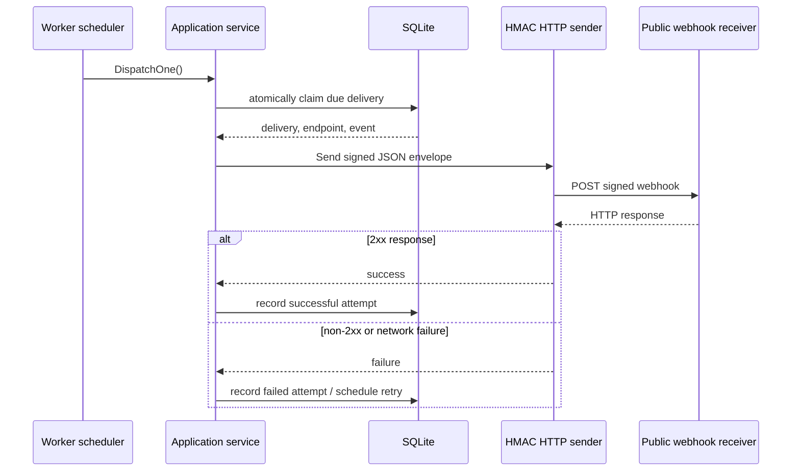
